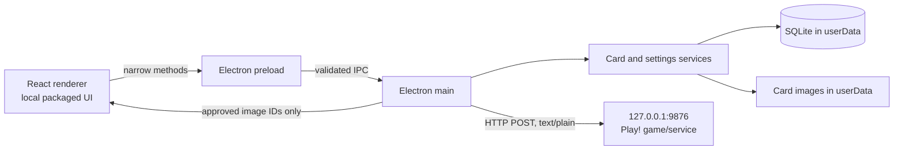

# Target architecture — Phase 01

## Scope and decisions

Animal Kaiser Scanner is one installed Windows application built with Electron, React, Vite, JavaScript, and SQLite. It serves one user's local cards and talks to the game running locally in Play! through the observed HTTP endpoint. Normal use requires no PHP, XAMPP, Node.js, npm, separate database server, account, or cloud service. The user will enter cards manually; this architecture does not include legacy-data transfer.

`../../answers.txt` and later user clarifications override older prompt assumptions. The legacy SQLite schema was inspected read-only in `DATABASE_ANALYSIS.md` (52 Animal, 20 Strong, 30 Miracle rows); it is a field/behavior reference, not a transfer source for this project. The new database starts empty. Do not rebuild Laravel `users`, `sessions`, password-reset, cache, queue, mail, or demo features merely because they exist in the source. A desktop schema-version mechanism is still needed.

## Process architecture

- **Renderer:** navigation, forms, six-card catalogue pages, search, filters, rarity sort, theme, dialogs/toasts, and visible game-send status. It cannot access Node.js, SQLite, arbitrary files, or network endpoints directly.
- **Preload:** exposes only typed-in-practice, named application methods through `contextBridge`, such as `cards.list/get/create/update/delete`, `scanner.sendManual/sendSaved`, `settings.get/update`, and `images.choose`. No generic `invoke(channel, payload)`, filesystem API, raw HTTP proxy, or legacy import API.
- **Main:** owns window lifecycle, IPC sender checks, authoritative validation, SQLite connections/migrations, image operations, game HTTP, settings persistence, and error translation. Keep service code separate from Electron event handlers so it can be tested.
- **Local game/service:** retain `POST http://127.0.0.1:9876/sys147/barcode`, `Content-Type: text/plain`, raw eight-character code. The main process initiates it. The desktop app opens no inbound web port. Any port setting is for the observed outbound game endpoint and remains loopback-only; there is no need for a Laravel-style app port.

Use a packaged local UI origin and a tightly scoped image-serving mechanism. An Electron custom protocol can serve packaged UI and card images by opaque card ID, with path checks in main; the renderer must never receive an unrestricted file path. Electron documents [custom protocol handling](https://www.electronjs.org/docs/latest/api/protocol) and recommends limiting `file://` use in its [security checklist](https://www.electronjs.org/docs/latest/tutorial/security). Final scheme registration and packaging details belong to implementation phases.

## Persistence design

Store application data under a dedicated subdirectory of `app.getPath('userData')`, for example `userData/data/ak-scanner.sqlite`, `userData/images/`, and `userData/backups/`. This keeps user data outside the installed application, supports upgrades, and follows Electron's [userData directory guidance](https://www.electronjs.org/docs/latest/api/app). Do not ship the inspected legacy database as a preloaded desktop database.

Use **one `cards` table** with category `animal | strong | miracle`, common fields (`id`, `nama`, `rarity`, `card_code`, `image_path`, created/updated timestamps), and category-specific fields (`gold_attack`, `type`, three Strong levels, `aura`, `effect`). This makes `UNIQUE(card_code)` enforce the user's global uniqueness requirement across all categories. Choose `INTEGER PRIMARY KEY` for new desktop IDs; no `legacy_id` or import metadata is needed. Domain `CHECK`s and service validation should enforce category-appropriate values. Normal card creation requires an image. Exact DDL belongs to Phase 04.

Version the desktop schema with `PRAGMA user_version` and ordered, transactional migrations; SQLite reserves this integer for application use ([SQLite PRAGMA reference](https://www.sqlite.org/pragma.html#pragma_user_version)). Enable foreign keys per connection if any future table relationships require them. Use prepared statements for user input. Provide a consistent database backup operation using SQLite's [online backup API](https://www.sqlite.org/backup.html), including before schema upgrades. This protects manually entered desktop data and does not require Laravel's `migrations` table.

Images live as files under the dedicated userData image directory; the database stores application-controlled relative references. New/replacement images are checked for type and size, copied to a staged location, and renamed only when the record operation can complete. Delete old files after DB success, with recovery for partial failures. Serve by card ID after main-process lookup, not by renderer-supplied path. Backups should cover both the desktop DB and its images.

Settings are small, local, and allowlisted: theme (`system`, `light`, `dark`) and, only if needed, the game endpoint's loopback port. Persist them in an atomic local settings file or small target table; do not include Laravel user/session data. The user has supplied `../../app-icon.png`, a transparent 531×175 logo; packaging will derive a readable square Windows icon from it.

## User workflows and UX

- Home keeps manual code entry on the left and Animal/Strong/Miracle navigation on the right. Category colours and card layout remain recognizable; light and dark themes preserve the same identity.
- Catalogue lists keep search and six-card pages. Add Animal filters for rarity/gold attack/type; Strong for rarity/each level/aura; Miracle for rarity/effect/type. Sort by rarity only, ascending or descending, with a stable timestamp/ID tie-breaker. Preserve legacy newest-first as the default when no rarity sort is selected.
- Add/edit/delete support manually selected card images. Authoritative validation uses exactly eight characters, lowercase `bn`, and a suffix compatible with legacy punctuation; the current data fits printable non-whitespace ASCII. Global code uniqueness is checked at DB and service boundaries. Saved-card Use reads the validated stored code by ID and does not revalidate it on every click.
- CRUD actions show clear success/failure/error/warning feedback and field-specific errors; no important failure is silent. Game sends use a clear inline/status outcome without routine CRUD toasts. Advance Animal → Strong → Miracle → Home only after an HTTP success response. HTTP acceptance is not proof the game completed a scan.
- The user-supplied icon is required for final Windows packaging. Do not stretch the user's wide logo into a square; derive a readable small-icon treatment from the provided asset when it arrives.

## Deferred verification

The exact service response body and the game's accepted barcode alphabet are not proven by source. The Phase 03 live check found Play! listening on port 9876 and returning HTTP 200, while the in-game effect was not observed. The icon source is available at `../../app-icon.png`; deriving the Windows icon belongs to packaging. Phase 10 checks readiness for manual entry and persistence, rather than inspecting or importing the legacy database. These unknowns do not require reverse engineering the emulator to design the desktop process boundary.
